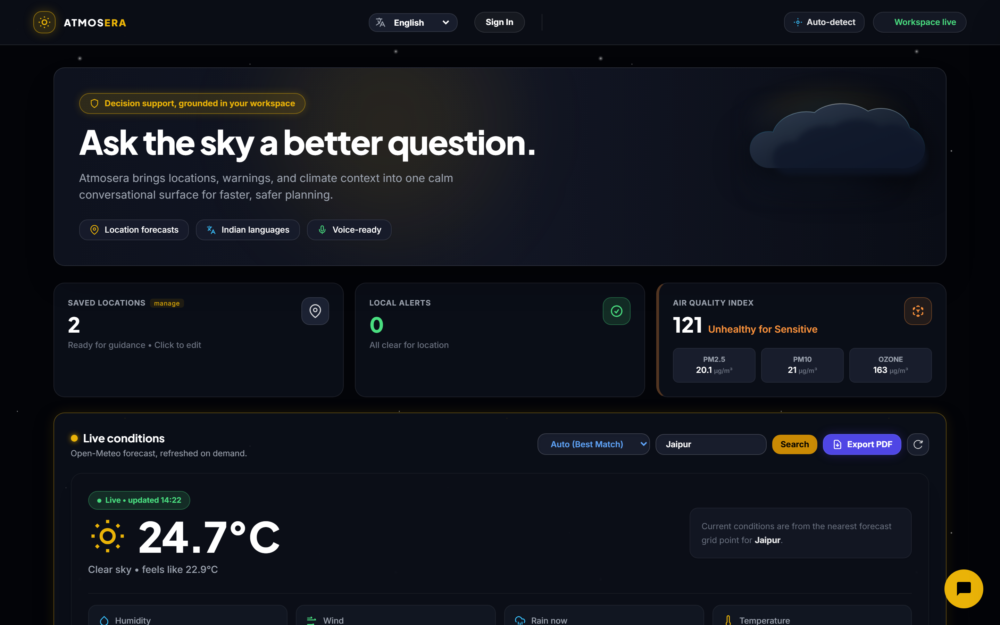
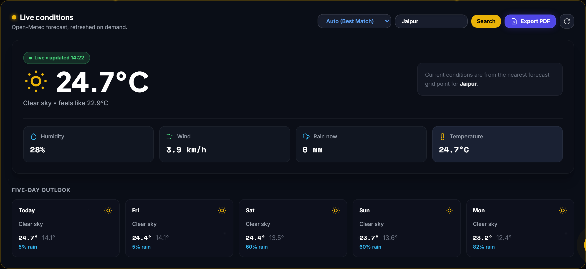
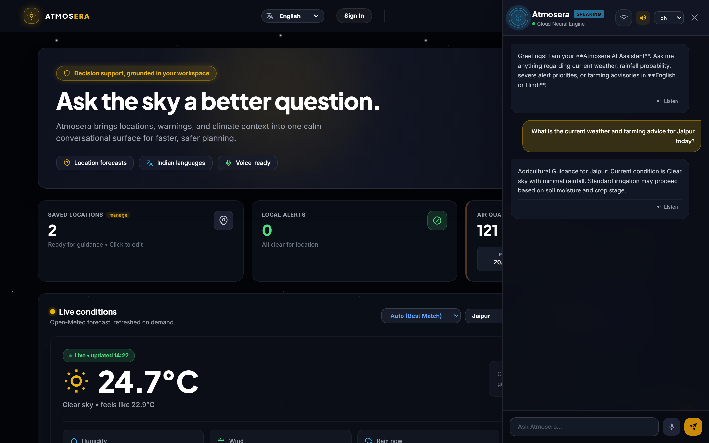
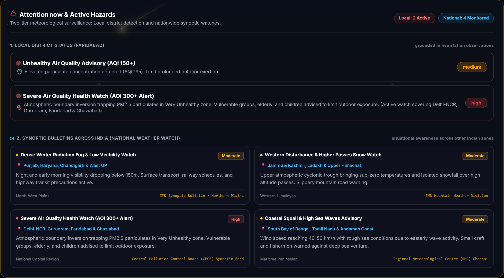
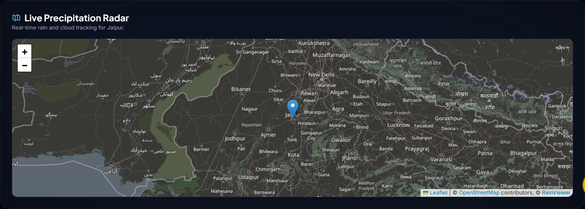

<p align="center">
  
</p>

<h1 align="center">Atmosera</h1>
<p align="center">
  <strong>AI-Powered Meteorological Intelligence &amp; Rural Advisory Dashboard</strong>
</p>

<p align="center">
  <a href="https://atmosera.vercel.app"></a>
  <a href="https://atmosera-api.onrender.com/docs"></a>
  <a href="https://react.dev"></a>
  <a href="https://vitejs.dev"></a>
  <a href="https://www.sqlite.org"></a>
  <a href="https://tailwindcss.com"></a>
</p>

<p align="center">
  <a href="documents/ATMOSERA%20Report.pdf">📄 Read the Major Project Report (PDF)</a>
</p>

---

## Overview

**Atmosera** is a client–server meteorological intelligence and rural decision-support web application built with **React 19 + Vite** and **FastAPI + SQLite**. It pairs live numerical weather predictions and US Air Quality Index feeds from **Open-Meteo** with deterministic hazard rules, interactive **Leaflet / RainViewer** radar maps, client-side PDF export, and a live-grounded **English / Hindi** conversational assistant with an offline 6-branch fallback engine.

- **Live Frontend:** [atmosera.vercel.app](https://atmosera.vercel.app)
- **Live Backend API & Swagger Docs:** [atmosera-api.onrender.com/docs](https://atmosera-api.onrender.com/docs)
- **Full Documentation:** [ATMOSERA Report.pdf](documents/ATMOSERA%20Report.pdf)

---

## Dashboard & Key Screens

### Main Workspace & Overview
Live telemetry summary showing saved locations, active local hazard count, live US AQI card, and current meteorological conditions retrieved on demand for the selected location.



### Multi-Model Forecast & Live Metrics
Switch dynamically across four Open-Meteo numerical models (**Auto Best Match**, **ECMWF IFS**, **NCEP GFS**, and **DWD ICON**) with real-time metric cards, hourly breakdown, five-day outlook, and one-click `jsPDF` + `html2canvas` dashboard export.



### Grounded Multilingual AI Assistant
Reads live retrieved conditions, forecasts, AQI, and active alerts into its prompt for **Google Gemini (`gemini-3.8-flash`)** and **Groq (`llama-3.3-70b-versatile`)**, and automatically falls back cleanly to a 6-branch bilingual offline heuristic engine (**Rain**, **Farming**, **Aviation**, **Marine**, **Urban**, and **Default Summary**) in **English** or **Hindi** with **Web Speech API** voice support.



### Two-Tier Local Alerts & National Synoptic Watch
`detect_all_weather_alerts()` evaluates severe weather codes (`95/96/99`), heat ($\ge 40\,^\circ\text{C}$), cold wave ($\le 3.0\,^\circ\text{C}$), rain ($\ge 10\text{ mm}$), wind ($\ge 40\text{ km/h}$), US AQI severity bands (`150+` / `200+` / `300+`), and matching regional synoptic bulletins concurrently.



### Live Precipitation Radar
Interactive geospatial radar built on **Leaflet**, **OpenStreetMap**, and **RainViewer** radar tiles with maritime coordinate fallback support (e.g., South Bay of Bengal).



---

## Key Capabilities

1. **Live Open-Meteo Weather, Forecast & US AQI:** District geocoding, 10-zone Indian maritime registry fallback, four selectable NWP models (`Best Match`, `ECMWF IFS`, `GFS`, `ICON`), hourly trends, 5/7-day forecasts, and six-pollutant AQI breakdown.
2. **Concurrent Multi-Tier Alert & Risk Engine:** Evaluates all matching meteorological, AQI (`150+` / `200+` / `300+`), and national synoptic hazards simultaneously alongside a 5-factor composite risk score (`0–100`).
3. **Rule-Based Advisories & Farmer Subscriptions:** Actionable heat, humidity/fungal-risk, rain, and wind advisories plus farmer phone registration (`farmer_subscribers`) and bulletin dispatch preview (`Fast2SMS` / `CallMeBot` gateway calls require live operator credentials; offline fallback returns simulated status).
4. **Grounded Cloud AI + Offline Heuristic Engine:** Attempts Gemini then Groq with live-telemetry prompt grounding; supports toggling offline mode cleanly without runtime exceptions across all 6 domain branches.
5. **Multilingual & Voice Interface:** `English` / `Hindi` assistant mode, browser Web Speech recognition & synthesis, and a navbar **Google Translate** widget for UI-level translation.
6. **Real-Time WebSocket Stream & PWA Support:** `/ws/alerts` connection manager with test broadcast endpoint (`/ws/trigger_test_alert`), installable web-app manifest, and static shell service worker (`frontend/public/sw.js`).
7. **Prototype Analytics Views:** Historical climate trend and crop-yield charts are currently prototype visualizations served from `/analytics/historical` synthetic series.

---

## Architecture & Tech Stack

- **Frontend (Vercel):** React 19, Vite 8, Tailwind CSS, Recharts, Leaflet & React-Leaflet, RainViewer overlay, `jsPDF` + `html2canvas`, Web Speech API, PWA Service Worker.
- **Backend (Render):** Python 3, FastAPI (26 REST + WebSocket routes), Uvicorn, Pydantic Settings, SQLAlchemy ORM + SQLite (`users`, `user_preferences`, `weather_logs`, `alerts`, `farmer_subscribers`).
- **External Integrations:** Open-Meteo Weather/Forecast/AQI APIs, Google Gemini API, Groq API, OpenStreetMap & RainViewer tiles, Fast2SMS / CallMeBot (credential-gated).

---

## Quick Start Guide

### Option A: One-Click Launch (Windows)
Run [`run_atmosera.bat`](run_atmosera.bat) from the repository root to start the FastAPI server on port `8000` and the Vite dev server on port `5173`.

### Option B: Manual Setup (Two Terminals)

#### 1. Backend (Terminal 1)
```bash
cd backend
python -m venv venv

# Windows:
.\venv\Scripts\activate
# Linux / macOS:
source venv/bin/activate

pip install -r requirements.txt
uvicorn app.main:app --reload --port 8000
```
Interactive Swagger API docs: `http://127.0.0.1:8000/docs`

#### 2. Frontend (Terminal 2)
```bash
cd frontend
npm install
npm run dev
```
Frontend dev server: `http://localhost:5173`

---

## Cloud Deployment & Environment Configuration

- **Backend (Render):** Root directory `backend`, build `pip install -r requirements.txt`, start `uvicorn app.main:app --host 0.0.0.0 --port $PORT`.
- **Frontend (Vercel):** Root directory `frontend`, framework preset `Vite`, build `npm run build`, output `dist`, env variable `VITE_API_BASE_URL=https://atmosera-api.onrender.com`.

Environment template at [`backend/.env.example`](backend/.env.example):

```env
DATABASE_URL=sqlite:///./weathergpt.db
WEATHER_API_KEY=open-meteo
GROQ_API_KEY=your_groq_api_key_here
GEMINI_API_KEY=your_gemini_api_key_here
FAST2SMS_API_KEY=your_fast2sms_api_key_here
CALLMEBOT_APIKEY=
CORS_ORIGINS=
```

*(Note: Atmosera runs weather retrieval and the 6-branch offline assistant even with empty AI/SMS keys.)*

---

## Verification Summary

From the evaluation documented in [ATMOSERA Report.pdf](documents/ATMOSERA%20Report.pdf):
- **Backend Standalone Scripts:** `8 / 13` pass cleanly offline (`4` network-dependent Open-Meteo scripts blocked in offline sandbox, `1` skipped by design).
- **Isolated API & WebSocket Checks:** `6 / 6` pass (`/`, `/health`, `/openapi.json`, `/ws/alerts`, `/ws/trigger_test_alert`, `/analytics/historical`).
- **Live Browser & Cloud E2E Verification:** `5 / 5` verification suites (`AX-01`–`AX-05`) and `16` desktop/mobile/API screenshots captured against the live Vercel & Render deployments.

---

## Repository Structure

```text
Atmosera/
├── backend/
│   ├── app/
│   │   ├── api/                        # FastAPI REST & WebSocket routers (26 routes)
│   │   ├── database/                   # SQLAlchemy connection, CRUD & table init
│   │   ├── models/                     # users, user_preferences, weather_logs, alerts, farmer_subscribers
│   │   ├── services/                   # weather, alert_detector, advisory, llm_service, subscription
│   │   └── utils/                      # Location normalization helpers
│   ├── tests/                          # 13 standalone unit & integration scripts
│   ├── requirements.txt
│   └── .env.example
├── frontend/
│   ├── public/                         # PWA manifest & service worker
│   └── src/                            # React components, services & styles
├── documents/
│   └── ATMOSERA Report.pdf
├── images/                             # Curated screenshots & logo displayed in README.md
├── run_atmosera.bat
└── README.md
```

---

## Authors & Supervision
- **Anuj Modani** (`23BCON1747`) & **Sidharth Mathur** (`23BCON1975`) — Department of Computer Science & Engineering, JECRC University, Jaipur
- **Project Guide:** Ms. Nupur Choudhary, Assistant Professor

## License
This project is licensed under the MIT License.
